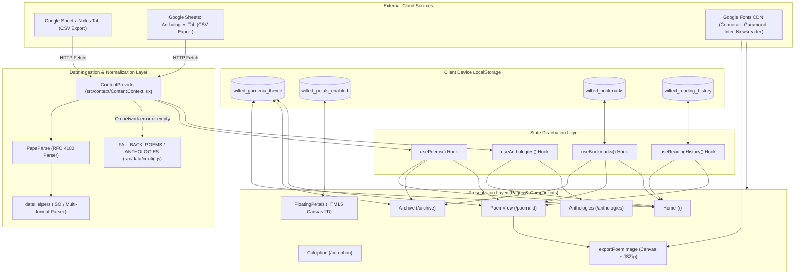
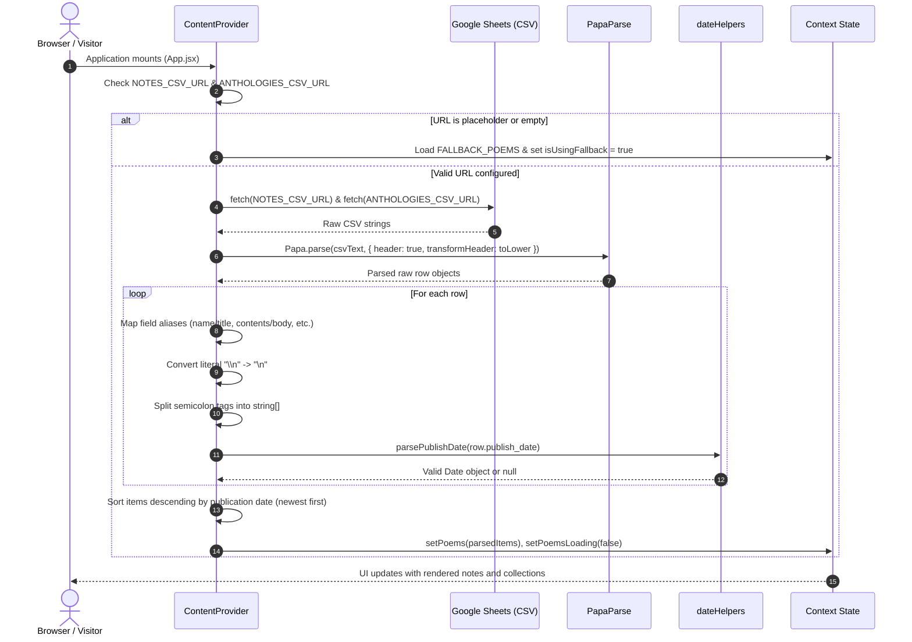
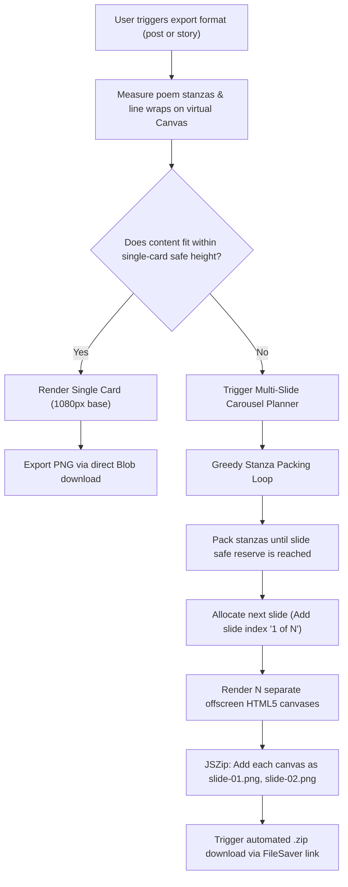

# Developer Knowledge Transfer (KT) & Technical Architecture Guide
## *Notes from a Wilted Gardenia*

> **Document Version:** 1.0.0  
> **Target Audience:** Incoming Software Engineers, Front-End Architects, and Contributors  
> **Curator & Lead Architect:** Rahul Gouri  
> **Last Updated:** November 2026  
> **Core Aesthetic Axiom:** *"Bruised parchment. Candlelight over ink. Editorial silence."*

---

## Table of Contents

1. [Executive Overview & Product Vision](#1-executive-overview--product-vision)
2. [Technology Stack & Core Dependencies](#2-technology-stack--core-dependencies)
3. [Repository Directory & File Map](#3-repository-directory--file-map)
4. [High-Level System Architecture](#4-high-level-system-architecture)
5. [Data Layer & Headless CMS Pipeline](#5-data-layer--headless-cms-pipeline)
   - [Google Sheets Headless CMS Integration](#google-sheets-headless-cms-integration)
   - [CSV Ingestion Lifecycle & ContentContext](#csv-ingestion-lifecycle--contentcontext)
   - [Data Normalization & Resilience Algorithms](#data-normalization--resilience-algorithms)
   - [Data Consumption Hooks](#data-consumption-hooks)
6. [Client-Side State & Local Storage Contracts](#6-client-side-state--local-storage-contracts)
7. [Subsystem Deep Dives](#7-subsystem-deep-dives)
   - [7.1 Ambient Canvas Petals Physics Engine (`FloatingPetals.jsx`)](#71-ambient-canvas-petals-physics-engine)
   - [7.2 High-Resolution Social Card & Carousel Generator (`exportPoemImage.js`)](#72-high-resolution-social-card--carousel-generator)
   - [7.3 Multi-Dimensional Archive Search & Filtering Engine (`Archive.jsx`)](#73-multi-dimensional-archive-search--filtering-engine)
   - [7.4 Reader Experience & Kindred Notes Algorithm (`PoemView.jsx`)](#74-reader-experience--kindred-notes-algorithm)
   - [7.5 Dynamic Discovery & Home Page Layers (`Home.jsx`)](#75-dynamic-discovery--home-page-layers)
8. [Design System & Styling Architecture](#8-design-system--styling-architecture)
   - [Design Token Architecture](#design-token-architecture)
   - [Typography Hierarchy & Font Loading](#typography-hierarchy--font-loading)
   - [Dual Theme System (Parchment vs. Bruised-Ink)](#dual-theme-system-parchment-vs-bruised-ink)
   - [CSS Architecture Rules](#css-architecture-rules)
9. [Routing & Navigation Architecture](#9-routing--navigation-architecture)
10. [Local Development Workflow & Tooling](#10-local-development-workflow--tooling)
11. [Step-by-Step Developer How-To Guides](#11-step-by-step-developer-how-to-guides)
12. [Production Build & Netlify Deployment](#12-production-build--netlify-deployment)
13. [Troubleshooting, Edge Cases & FAQ](#13-troubleshooting-edge-cases--faq)

---

## 1. Executive Overview & Product Vision

**Notes from a Wilted Gardenia** is a specialized, production-grade literary web archive engineered to preserve and present standalone poems, reflective prose, and curated anthologies.

Unlike standard portfolios or content management blogs, this system operates under strict editorial and aesthetic constraints:
1. **The Interface Defers Entirely to the Verse:** UI elements exist only to support contemplation, reading comfort, and organic discovery. Visual noise, aggressive animations, tracking cookies, and heavy popups are strictly absent.
2. **Zero-Database Serverless Headless CMS:** Content is maintained by writers and curators via a standard Google Sheet published as public CSV feeds. The front-end fetches, parses, normalizes, and indexes this data client-side upon initial load.
3. **Zero Remote Tracking / Privacy-First:** Reader history, saved bookmarks, ambient animations, and theme preferences reside purely within device `localStorage`. No user accounts, passwords, or tracking telemetry exist.
4. **Editorial Tactility & Craftsmanship:** The project integrates custom mathematical particle physics for ambient drifting gardenia petals, hand-coded SVG copperplate botanical engravings, and an in-browser HTML5 Canvas export engine capable of generating multi-slide Instagram carousels packaged directly into `.zip` archives.

---

## 2. Technology Stack & Core Dependencies

```
┌────────────────────────────────────────────────────────────────────────┐
│                          APPLICATIONS & RUNTIME                        │
│                                                                        │
│   React 19.x (Hooks & Context)          React Router DOM 7.x (SPA)     │
│   Vite 8.x (ESM Bundler & HMR)          Oxlint 1.8x (Rust Linter)      │
└───────────────────────────────────┬────────────────────────────────────┘
                                    │
┌───────────────────────────────────┴────────────────────────────────────┐
│                         SPECIALIZED LIBRARIES                          │
│                                                                        │
│   PapaParse 5.7.x                       JSZip 3.10.x                   │
│   - RFC 4180 CSV parsing in browser    - In-memory multi-canvas export │
│   - Header auto-transform & stream     - Dynamic ZIP archive bundling  │
└───────────────────────────────────┬────────────────────────────────────┘
                                    │
┌───────────────────────────────────┴────────────────────────────────────┐
│                         INFRASTRUCTURE & HOSTING                       │
│                                                                        │
│   Google Sheets CSV Engine             Netlify CDN & Edge Network      │
│   - Public web published CSV endpoints - SPA rewrite engine (/* 200)   │
│   - Live instant updates without build - Brotli/Gzip static asset CDN  │
└────────────────────────────────────────────────────────────────────────┘
```

### Dependency Audit

| Package | Version | Architectural Responsibility |
|---|---|---|
| `react` | `^19.2.8` | Component model, state lifecycle, Context API, dynamic DOM rendering. |
| `react-dom` | `^19.2.8` | Virtual DOM mounting and client-side reconciliation. |
| `react-router-dom` | `^7.18.3` | Client-side routing, query parameter synchronization (`useSearchParams`), navigation guard rails. |
| `papaparse` | `^5.7.0` | High-performance, streaming client-side CSV parser. Tolerates malformed lines and quotes. |
| `jszip` | `^3.10.2` | Compiles multiple HTML5 canvas export buffers into a single `.zip` file for social media carousels. |
| `vite` | `^8.3.0` | Development server with instant HMR and Rollup-based production tree-shaking compiler. |
| `@vitejs/plugin-react`| `^6.1.1` | Babel/Fast-Refresh bridge for React 19 JSX transformations. |
| `oxlint` | `^1.81.0` | Next-generation Rust-based JavaScript/React linter for near-instant static verification. |

---

## 3. Repository Directory & File Map

```
NotesFromWiltedGardenia/
├── .gitignore                   # Git ignore patterns (node_modules, dist, env, OS files)
├── .oxlintrc.json               # Oxlint rules and strict static analysis configuration
├── index.html                   # HTML5 entrypoint, font preconnects, SEO metadata
├── netlify.toml                 # Netlify build commands and SPA wildcard redirect rules
├── package.json                 # Project dependencies, scripts, and module definitions
├── package-lock.json            # Deterministic dependency lockfile
├── README.md                    # Public-facing project overview and feature guide
├── DEVELOPER.md                 # This file: definitive architectural KT document
├── vite.config.js               # Vite bundler configuration with React plugin
├── public/                      # Static assets copied directly to build output
│   ├── _redirects               # Netlify fallback routing rule (/* /index.html 200)
│   ├── favicon.svg              # Browser tab icon (antique botanical gardenia leaf)
│   ├── gardenia.svg             # Primary high-res vector gardenia emblem
│   └── icons.svg                # Reusable SVG symbol definitions
└── src/
    ├── main.jsx                 # React root renderer with BrowserRouter
    ├── App.jsx                  # Primary shell: layout, canvas overlays, header, routes, footer
    ├── App.css                  # Intentional stub: points to index.css
    ├── index.css                # Monolithic design system: variables, themes, component CSS
    ├── assets/                  # Bundled assets (hero illustrations, logos)
    ├── components/              # Modular, reusable presentation & container components
    │   ├── AnthologyCard.jsx    # Bound anthology book cover card
    │   ├── ErrorState.jsx       # Graceful literary error boundary card
    │   ├── FloatingPetals.jsx   # Ambient canvas particle physics simulation
    │   ├── Footer.jsx           # Global site footer with colophon links and copyright
    │   ├── GardeniaBackgroundMotif.jsx # Copperplate watermark engraving SVG overlays
    │   ├── GardeniaEmblem.jsx   # Vector rosette botanical gardenia flower emblem
    │   ├── Header.jsx           # Top navigation, ambient controls, theme switcher, mobile menu
    │   ├── LoadingState.jsx     # Atmospheric skeleton loader for text and cards
    │   ├── NoteCard.jsx         # Card component for individual poem previews
    │   ├── OnThisDay.jsx        # Historical anniversary detector and display component
    │   ├── PetalDivider.jsx     # Ornamental flourished typographic divider
    │   ├── RecentlyRead.jsx     # Shelf of recently opened notes from localStorage
    │   └── StartHere.jsx        # Curated onboarding pathway for first-time visitors
    ├── context/                 # Centralized React Context data layer
    │   ├── contextDefinition.js # createContext instance definition
    │   ├── ContentContext.jsx   # Ingestion engine: fetches CSVs, parses, and distributes state
    │   └── useContent.js        # Internal consumer hook for ContentContext
    ├── data/                    # Configuration and public consumer hooks
    │   ├── config.js            # Live CSV endpoints, fallbacks, mood maps, curator constants
    │   ├── usePoems.js          # Dedicated hook exposing normalized poems state
    │   └── useAnthologies.js    # Dedicated hook exposing normalized anthologies state
    ├── hooks/                   # Custom business logic & persistent device state hooks
    │   ├── useBookmarks.js      # LocalStorage bookmark manager (CRUD for saved poems)
    │   ├── useDocumentTitle.js  # Reactive browser tab title updater
    │   └── useReadingHistory.js # LocalStorage reading history tracker (FIFO capped at 20)
    ├── pages/                   # Top-level view routes
    │   ├── Home.jsx             # Layered landing: prologue, start here, history, recent notes
    │   ├── Archive.jsx          # Comprehensive archive with multi-filter and live search
    │   ├── PoemView.jsx         # Single poem reader: typography tools, share, export, kindred notes
    │   ├── Anthologies.jsx      # Grid view of curated volumes and themed long-form cycles
    │   └── Colophon.jsx         # Archival purpose, developer colophon, technical craftsmanship
    └── utils/                   # Pure utility functions and mathematical engines
        ├── dateHelpers.js       # Resilient CSV date parser, ISO converter, and display formatter
        ├── exportPoemImage.js   # 800-line Canvas rendering engine: IG Post/Story and ZIP carousels
        ├── poemHelpers.js       # Stanza counter, word counter, and estimated read-time calculator
        └── relatedPoems.js      # Kindred notes scoring algorithm (tag overlap + recency)
```

---

## 4. High-Level System Architecture

The following diagram illustrates the complete runtime architecture, data pipeline, and state distribution:



---

## 5. Data Layer & Headless CMS Pipeline

### Google Sheets Headless CMS Integration

The application eliminates database maintenance and administrative backends by using a live Google Sheet. Content editors author poems and anthologies in their spreadsheet, which is published to the web as two CSV endpoints defined in `src/data/config.js`:

```javascript
// src/data/config.js
export const NOTES_CSV_URL = "https://docs.google.com/spreadsheets/d/e/.../pub?gid=302744447&single=true&output=csv";
export const ANTHOLOGIES_CSV_URL = "https://docs.google.com/spreadsheets/d/e/.../pub?gid=118497514&single=true&output=csv";
```

#### Expected CSV Schemas

##### 1. Standalone Notes Sheet (`NOTES_CSV_URL`)
| Primary Column | Recognized Aliases | Data Type | Notes / Processing |
|---|---|---|---|
| `id` | - | String | URL slug (e.g., `the-unsaid-waltz`). If missing, auto-slugified from title or generated. |
| `name` | `title` | String | **Required.** Title of the note/poem. Rows without a name are discarded. |
| `author` | `poet` | String | Attribution. Defaults to `DEFAULT_AUTHOR` (`"Unrecorded Author"`). |
| `intro` | `excerpt` | String | 1–2 line epigraph, italicized preface, or dedication. |
| `contents` | `content`, `body` | String | Full poem body. Literal `\n` character sequences are converted to actual newlines. |
| `publish_date`| `date` | String | Supports ISO `YYYY-MM-DD`, `M/D/YYYY`, `D.M.YYYY`, or `YYYY`. |
| `tags` | `tag` | String | Semicolon-delimited tags (e.g., `silence; night; memory`). Parsed into an array. |

##### 2. Curated Anthologies Sheet (`ANTHOLOGIES_CSV_URL`)
| Primary Column | Recognized Aliases | Data Type | Notes / Processing |
|---|---|---|---|
| `id` | - | String | Unique slug identifier for the collection. |
| `title` | `name` | String | **Required.** Title of the anthology volume. |
| `author` | `curator` | String | Curator or author attribution. Defaults to `DEFAULT_CURATOR`. |
| `subtitle` | - | String | Secondary descriptive header. |
| `description` | `synopsis` | String | Curatorial synopsis explaining the collection's theme. |
| `link_url` | `url`, `link` | String | Optional external URL (Substack, PDF, physical volume, or publication). |
| `status_or_tag` | `tag`, `status` | String | Badge metadata (e.g., `"Complete"`, `"Open Cycle"`, `"Bound Volume"`). |

---

### CSV Ingestion Lifecycle & ContentContext

`src/context/ContentContext.jsx` acts as the single source of truth for all remote data. The fetch and parse lifecycle is structured as follows:



### Data Normalization & Resilience Algorithms

Google Sheets exports can introduce subtle data anomalies that would break standard web apps. The ingestion layer applies several defensive transforms:

1. **Header Sanitization:**
   ```javascript
   transformHeader: (header) => header.trim().toLowerCase()
   ```
   Ensures headers like `" Publish Date "` or `"Title"` are read uniformly regardless of spreadsheet casing or accidental whitespace.

2. **Literal Newline Replacement:**
   When authors write multiline poetry in spreadsheet cells, some platforms export literal backslash-n sequences (`\n`) rather than true line breaks. The ingestion converts them:
   ```javascript
   contents: (row.contents || row.content || row.body || "").replace(/\\n/g, "\n")
   ```

3. **Multi-Format Date Parsing (`src/utils/dateHelpers.js`):**
   `parsePublishDate(raw)` evaluates raw strings through regex matchers:
   - ISO `YYYY-MM-DD` (`/^(\d{4})-(\d{2})-(\d{2})$/`)
   - US Locale `M/D/YYYY` (`/^(\d{1,2})\/(\d{1,2})\/(\d{4})$/`)
   - European Dot notation `D.M.YYYY` (`/^(\d{1,2})\.(\d{1,2})\.(\d{4})$/`)
   - Year Only `YYYY` (`/^(\d{4})$/`)
   - Native JavaScript `Date.parse()` fallback.
   This guarantees that date-based sorting (`b.date - a.date`) never encounters `NaN`.

4. **Zero-Crash Fallback Safety:**
   If a network outage occurs, the sheet returns HTTP 500, or the CSV is unparseable, `ContentContext` catches the exception, logs it to `console.error`, and populates state with `FALLBACK_POEMS` or `FALLBACK_ANTHOLOGIES`, setting `poemsFallback = true`. The user is informed via a graceful banner without a broken UI.

---

### Data Consumption Hooks

Developers must never consume `ContentContext` directly in feature components. Instead, import the specialized domain hooks:

```javascript
// Consuming Standalone Poems
import { usePoems } from "../data/usePoems";

function MyComponent() {
  const { poems, loading, error, isUsingFallback } = usePoems();
  // poems: Array of normalized poem objects
}

// Consuming Anthologies
import { useAnthologies } from "../data/useAnthologies";

function AnthologyList() {
  const { anthologies, loading, error, isUsingFallback } = useAnthologies();
  // anthologies: Array of normalized anthology objects
}
```

---

## 6. Client-Side State & Local Storage Contracts

All user state is persistent, local-only, and strictly typed in adherence to these contracts:

| Key | Format / Type | Default | Managed By | Purpose |
|---|---|---|---|---|
| `wilted_gardenia_theme` | `"light"` \| `"dark"` | `"light"` | `Header.jsx` | Controls `data-theme` attribute on `<html>`. Toggles light parchment or dark bruised-ink styles. |
| `wilted_petals_enabled` | `"true"` \| `"false"` | `"true"` | `App.jsx` | Toggles canvas rendering of ambient drifting petals. |
| `wilted_bookmarks` | `string[]` (JSON serialized) | `[]` | `useBookmarks.js` | Array of poem `id` strings saved by the reader. |
| `wilted_reading_history` | `Array<{ id: string, readAt: string }>` | `[]` | `useReadingHistory.js` | FIFO list of recently viewed poem IDs and ISO timestamps. Capped at 20 items. |

### Hook Contract: `useBookmarks()`
```javascript
// src/hooks/useBookmarks.js
const { bookmarks, isBookmarked, toggleBookmark } = useBookmarks();
// isBookmarked("note-1") -> returns boolean
// toggleBookmark("note-1") -> adds or removes ID, persists to localStorage
```

### Hook Contract: `useReadingHistory()`
```javascript
// src/hooks/useReadingHistory.js
const { history, recordRead } = useReadingHistory();
// recordRead("note-1") -> prepends item, deduplicates, caps length to MAX_HISTORY (20)
// history -> [{ id: "note-1", readAt: "2026-11-01T20:00:00.000Z" }, ...]
```

---

## 7. Subsystem Deep Dives

### 7.1 Ambient Canvas Petals Physics Engine

**File:** `src/components/FloatingPetals.jsx`

The drifting gardenia petals are not CSS keyframe sprites; they are rendered via a dedicated HTML5 Canvas 2D simulation engineered for organic, meditative movement.

#### Physics & Particle Anatomy
Each particle represents a gardenia petal (`Gardenia jasminoides`) with realistic botanical proportions:
- **Aspect Ratio:** Slender petal shape where `width = length * (0.46 to 0.56)`.
- **Botanical Silhouette:** Formed using two cubic Bezier curves (`bezierCurveTo`) converging at a delicate apical tip, complete with an inner translucent midrib stroke.
- **3D Aerodynamics (Pitch, Roll, Yaw):**
  - **Yaw (`angle`):** 2D planar rotation as the petal drifts down-screen.
  - **Pitch (`flipAngle`):** Tumbling motion modeled via `Math.cos(flipAngle)`, causing the petal to visually compress and flip along its vertical axis.
  - **Roll (`rollAngle`):** Horizontal oscillation modeled via `Math.sin(rollAngle)`, simulating air resistance and lateral flutter.
- **Color Gradients:** Radial and linear gradients reflecting aged ivory petals with bruised, tea-wilted margins (`#eee6d8` to `#cfbda8` in light mode, `#caa07b` in dark mode).

#### Performance & Accessibility Guardrails
- **Reduced Motion:** Listens to `window.matchMedia("(prefers-reduced-motion: reduce)")`. If the user has reduced motion enabled in their OS, canvas execution is halted.
- **Page Visibility API:** Binds to `document.addEventListener("visibilitychange")`. When the browser tab is hidden or minimized, `cancelAnimationFrame` freezes the loop to prevent CPU and battery drain.
- **Viewport Throttling:** Particle count dynamically scales with screen width:
  ```javascript
  const petalCount = Math.min(7, Math.max(4, Math.floor(window.innerWidth / 280)));
  ```
  This caps active particles between 4 and 7, preserving an uncluttered reading environment.

---

### 7.2 High-Resolution Social Card & Carousel Generator

**File:** `src/utils/exportPoemImage.js`

Readers can export any poem as a high-resolution, theme-aware social media image card. For longer poems that exceed single-card legibility, the engine automatically splits stanzas across multiple slides and compiles them into a downloadable `.zip` carousel.

#### Export Specifications & Dimensions

| Format Key | Name | Aspect Ratio | Dimensions | Use Case |
|---|---|---|---|---|
| `post` | IG Post | 4:5 | **1080 × 1350 px** | Standard Instagram feed portrait post. |
| `story` | IG Story | 9:16 | **1080 × 1920 px** | Fullscreen vertical Instagram / TikTok / WhatsApp Story. |

#### Safe Area Clearance
Instagram Stories overlay active UI controls (profile photo, username, and timer bars at the top; message reply input and share icons at the bottom). `FORMATS.story` defines strict clearance buffers:
- `headerTop: 155px` (clears profile avatar and story timer bars)
- `footerBottom: 210px` (clears "Send Message" and reaction trays)

#### Multi-Slide Greedy Pagination Algorithm
The export engine inspects poem length and layout height before rendering:



#### Theme Synchronization & Vector Engravings
- **Theme Awareness:** Reads `document.documentElement.getAttribute("data-theme")`. Automatically switches between `THEME_PALETTES.light` (warm parchment) and `THEME_PALETTES.dark` (candlelit midnight ink).
- **High-DPI Botanical Engravings:** Renders intricate copperplate gardenia blossom vectors directly onto the canvas context using serialized SVG path data wrapped in `new Path2D(d)`.
- **Font Assurance:** Waits for `document.fonts.ready` before rasterizing text, ensuring `Cormorant Garamond` glyphs never render with fallback system fonts.

---

### 7.3 Multi-Dimensional Archive Search & Filtering Engine

**File:** `src/pages/Archive.jsx`

The Archive view provides real-time client-side filtering across multiple dimensions without network round-trips:

```
┌────────────────────────────────────────────────────────────────────────┐
│  Search Input: [ "silence"                                          ]  │
│                                                                        │
│  Mood Chips:   [ All ] [ Heartbreak ] [ Solitude* ] [ Resilience ]     │
│                                                                        │
│  Tag Chips:    [ All ] [ night* ] [ insomnia ] [ quiet ] [ memory ]    │
│                                                                        │
│  Year Filter:  [ All Years ▾ ]     [x] Bookmarked Only                 │
└────────────────────────────────────────────────────────────────────────┘
```

#### Filter Intersections (Logical AND across categories, OR within tags)
A poem appears in the filtered list if and only if:
1. **Search Query:** Matches title (`name`), epigraph (`intro`), or poem body (`contents`) via case-insensitive substring search.
2. **Year Match:** `extractYear(poem.publish_date) === selectedYear` (or `"all"`).
3. **Bookmark Match:** `!onlyBookmarked || isBookmarked(poem.id)`.
4. **Mood Match:** If an active mood is selected (e.g., *"Solitude & Introspection"*), the poem must possess at least one tag present in `MOOD_MAP[activeMood]`:
   ```javascript
   // src/data/config.js
   export const MOOD_MAP = {
     "Heartbreak & Longing": ["heartbreak", "longing", "separation", "regret", "sorrow", "loss", "grief", "melancholy"],
     "Solitude & Introspection": ["solitude", "introspection", "insomnia", "silence", "night", "midnight", "shadows", "quiet"],
     ...
   };
   ```
5. **Tag Match:** `poem.tags.includes(activeTag)` (or `"all"`).

#### Dynamic Tag Cloud & URL Deep-Linking
- **Frequency Ranking:** Available tags are counted across all loaded poems; only the top 10 most frequent tags are displayed as filter chips to avoid clutter.
- **Selection Preservation:** If a reader visits an external deep link with `?tag=uncommon-tag`, the engine injects that tag into the chip bar even if it falls outside the top 10.
- **Browser History Integration:** Tag selection updates the browser query string (`?tag=...`) via `useSearchParams({ replace: true })`, allowing readers to bookmark or share specific tag views.

---

### 7.4 Reader Experience & Kindred Notes Algorithm

**File:** `src/pages/PoemView.jsx`

The individual poem reader is designed for deep literary immersion, equipped with dynamic reading tools:

1. **Scroll Reading Progress Bar:** An ultra-thin header progress bar tracks the reader's vertical scroll percentage:
   ```javascript
   const totalHeight = document.documentElement.scrollHeight - window.innerHeight;
   const progress = (window.scrollY / totalHeight) * 100;
   ```
2. **Dynamic Font Size Scaler:** Adjusts poem body typography between three tuned scales:
   - `small`: `1.05rem` / `line-height: 1.8`
   - `normal`: `1.22rem` / `line-height: 1.95`
   - `large`: `1.4rem` / `line-height: 2.1`
3. **Web Share API & Clipboard Fallback:**
   ```javascript
   if (navigator.share) {
     await navigator.share({ title: poem.name, text: poem.intro, url });
   } else {
     await navigator.clipboard.writeText(url);
     // shows "Copied!" toast confirmation
   }
   ```
4. **Kindred Notes Recommendation Algorithm (`src/utils/relatedPoems.js`):**
   Surfaces up to 3 thematically linked poems using tag intersection scoring:
   $$\text{Score}(P_A, P_B) = | \text{Tags}(P_A) \cap \text{Tags}(P_B) |$$
   Ties are broken by publication date (newest first). If no poems share tags, the section gracefully unmounts.
5. **Date-Based Chronological Pagination:**
   Previous and Next buttons navigate through the archive in chronological order. Because poems are presorted descending by date:
   - `prevPoem`: Earlier written piece (`currentIndex + 1`)
   - `nextPoem`: Later written piece (`currentIndex - 1`)

---

### 7.5 Dynamic Discovery & Home Page Layers

**File:** `src/pages/Home.jsx`

The landing page adapts dynamically based on reader state and historical dates:

```
┌─────────────────────────────────────────────────────────┐
│  Epigraph Banner: "A petal pressed into parchment..."   │
├─────────────────────────────────────────────────────────┤
│  Start Here (Curated path for first-time visitors)      │
│  * Automatically hides once reading history exists *    │
├─────────────────────────────────────────────────────────┤
│  Recently Read Shelf (Last 4 notes opened on device)    │
│  * Automatically unhides once reading history exists *  │
├─────────────────────────────────────────────────────────┤
│  On This Day (Anniversary matching today's Month & Day) │
│  * Appears only when historical date matches today *    │
├─────────────────────────────────────────────────────────┤
│  Recent Standalone Notes (Top 4 chronologically)        │
├─────────────────────────────────────────────────────────┤
│  Featured Bound Volume (Curated Anthology Anchor)       │
└─────────────────────────────────────────────────────────┘
```

- **"On This Day" Engine (`src/components/OnThisDay.jsx`):** Evaluates every poem's publication date against the current calendar day:
  ```javascript
  const isAnniversary = poemDate.getMonth() === today.getMonth() &&
                        poemDate.getDate() === today.getDate();
  ```
  Surfaces historical poems written on this exact day in previous years.
- **Adaptive Onboarding vs. History:**
  - New visitors see the curated **Start Here** 4-step pathway (`START_HERE_IDS` in `config.js`).
  - As soon as a note is opened, `useReadingHistory` registers an entry, causing **Start Here** to yield its prominent space to the **Recently Read** shelf.

---

## 8. Design System & Styling Architecture

### Design Token Architecture

All tokens are defined as CSS Custom Properties in `src/index.css`:

```css
/* src/index.css */
:root {
  /* Parchment Light Palette (Default) */
  --bg-parchment: #f9f6f0;
  --bg-parchment-glass: rgba(249, 246, 240, 0.92);
  --bg-card: #f3efe6;
  --bg-hover: #ece5d8;
  --bg-badge: #eee6d9;
  --border-delicate: #e6dfd2;
  --border-subtle: #d6cbba;

  --ink-primary: #231f1d;
  --ink-secondary: #595149;
  --ink-muted: #887d71;
  --ink-faint: #b4aa9d;

  --accent-gardenia: #8f6543;
  --accent-amber: #b0825c;
  --accent-tint: #f0e5d8;
  --accent-glow: rgba(143, 101, 67, 0.12);

  /* Typography */
  --font-serif: 'Cormorant Garamond', 'Newsreader', Garamond, Georgia, serif;
  --font-sans: 'Inter', system-ui, -apple-system, sans-serif;
  --font-mono: ui-monospace, SFMono-Regular, monospace;

  /* Layout Boundaries */
  --site-max-width: 1180px;
  --reading-max-width: 740px;

  /* Easing curves */
  --transition-gentle: all 0.28s cubic-bezier(0.16, 1, 0.3, 1);
  --transition-fluid: all 0.4s cubic-bezier(0.22, 1, 0.36, 1);
  --radius-subtle: 6px;
}
```

### Dual Theme System (Parchment vs. Bruised-Ink)

When the reader toggles theme, `Header.jsx` updates `<html data-theme="dark">`. The dark theme alters background and ink tokens to preserve eye comfort in dark rooms:

```css
[data-theme="dark"] {
  --bg-parchment: #171513;
  --bg-parchment-glass: rgba(23, 21, 19, 0.92);
  --bg-card: #211e1a;
  --bg-hover: #2c2722;
  --bg-badge: #2c2823;
  --border-delicate: #342d26;
  --border-subtle: #463d33;

  --ink-primary: #eee7dc;
  --ink-secondary: #c2b6a7;
  --ink-muted: #8e8375;
  --ink-faint: #5b5145;

  --accent-gardenia: #caa07b;
  --accent-amber: #dfb288;
  --accent-tint: #2a241e;
  --accent-glow: rgba(202, 160, 123, 0.16);
}
```

### Typography Hierarchy & Font Loading

Loaded via `<link>` in `index.html` from Google Fonts:
1. **`Cormorant Garamond` (Weights: 300, 400, 500, 600, Italic):** Used for site titles, page headers, epigraphs, and poetry body text. High-contrast classical serif styling.
2. **`Newsreader` (Weights: 300, 400, Italic):** Used for curatorial prefaces and editorial subtitles.
3. **`Inter` (Weights: 300, 400, 500):** Clean geometric grotesque used strictly for UI labels, search inputs, metadata timestamps, and button controls.

### CSS Architecture Rules

> [!IMPORTANT]
> **Single Source of Truth for Styles:**  
> All styling resides in `src/index.css`. `src/App.css` is intentionally left blank. Do not create isolated `.css` or CSS module files for individual components unless doing a full architectural refactor. Maintain all styles and media queries centrally in `index.css`.

- **Mobile Breakpoint:** `max-width: 768px`. Header controls collapse into the **⋯ Options** dropdown, padding scales down to `1rem`, and cards switch to single-column flex layouts.
- **Reading Container:** Poetry views are constrained by `--reading-max-width: 740px` to maintain an optimal reading measure (60–75 characters per line).

---

## 9. Routing & Navigation Architecture

Routing is managed by `react-router-dom` v7 in `src/App.jsx`. All routes render inside `<main className="main-container">`:

| Route Path | Element | Purpose |
|---|---|---|
| `/` | `<Home />` | Landing page, epigraph, onboarding path, recent notes, featured volume. |
| `/archive` | `<Archive />` | Full searchable catalog with mood, tag, year, and bookmark filtering. |
| `/notes` | `<Navigate to="/archive" replace />` | Legacy canonical alias redirecting to Archive. |
| `/poem/:id` | `<PoemView />` | Single poem reading room, font adjuster, card export, kindred notes. |
| `/anthologies` | `<Anthologies />` | Showcase of long-form curated volumes and collections. |
| `/colophon` | `<Colophon />` | Technical colophon, curatorial philosophy, and craft notes. |
| `/about`, `/note` | `<Navigate to="/colophon" replace />` | Convenience redirects for common navigation attempts. |
| `*` | `<404 Unpenned Page />` | Themed 404 handler with a direct return link to `/`. |

### Server-Side Rewrite Rule (Single Page App)
Because routing is handled client-side by React Router, direct visits or hard refreshes on `/poem/note-1` must be routed to `index.html`. This is handled by `public/_redirects` and `netlify.toml`:
```toml
# netlify.toml
[[redirects]]
  from = "/*"
  to = "/index.html"
  status = 200
```

---

## 10. Local Development Workflow & Tooling

### Prerequisites
- **Node.js:** v18.0.0 or higher (Node 20+ recommended).
- **Package Manager:** `npm` (v9+).

### Quickstart Setup

1. **Clone & Install Dependencies:**
   ```bash
   git clone https://github.com/<your-repo>/NotesFromWiltedGardenia.git
   cd NotesFromWiltedGardenia
   npm install
   ```

2. **Start Local Development Server:**
   ```bash
   npm run dev
   ```
   Vite starts the local server at `http://localhost:5173/` with instant hot module replacement.

3. **Run Code Quality Linting:**
   ```bash
   npm run lint
   ```
   Executes `oxlint` across all JavaScript and JSX source files. Takes under 100ms.

4. **Test Production Build Locally:**
   ```bash
   npm run build
   npm run preview
   ```
   Rollup bundles assets into `/dist`, and Vite spins up a local production preview server.

---

## 11. Step-by-Step Developer How-To Guides

### How-To: Connect a New Google Sheet as the CMS

1. Create a Google Sheet with two tabs: `notes` and `anthologies`.
2. Format columns according to the schema in [Section 5](#expected-csv-schemas).
3. In Google Sheets, navigate to:  
   **File → Share → Publish to web**.
4. In the dialog:
   - Select the `notes` tab.
   - Choose **Comma-separated values (.csv)** as the format.
   - Click **Publish**.
   - Repeat for the `anthologies` tab.
5. Copy the generated URLs and paste them into `src/data/config.js`:
   ```javascript
   export const NOTES_CSV_URL = "https://docs.google.com/spreadsheets/d/e/.../pub?gid=...&single=true&output=csv";
   export const ANTHOLOGIES_CSV_URL = "https://docs.google.com/spreadsheets/d/e/.../pub?gid=...&single=true&output=csv";
   ```

### How-To: Add a New Mood Category to the Archive

1. Open `src/data/config.js`.
2. Add your new mood key and its associated tag list to `MOOD_MAP`:
   ```javascript
   export const MOOD_MAP = {
     // ... existing moods
     "Autumn & Decay": ["autumn", "leaves", "rain", "rust", "october", "decay", "withering"],
   };
   ```
3. The Archive filter bar (`src/pages/Archive.jsx`) automatically renders the new mood chip and binds its tag intersections.

### How-To: Add a New Card Export Ratio

1. Open `src/utils/exportPoemImage.js`.
2. Add a new configuration to `FORMATS`:
   ```javascript
   export const FORMATS = {
     // ... existing 'post' and 'story'
     square: {
       id: "square",
       label: "Square",
       aspectRatioLabel: "1:1",
       sublabel: "Classic Square",
       width: 1080,
       height: 1080,
       maxContentWidth: 840,
       headerTop: 70,
       contHeaderTop: 90,
       footerBottom: 90,
       singleBottomReserve: 180,
       multiSlideBottomReserve: 130,
       lastSlideBottomReserve: 210,
       fileSuffix: "-square",
     },
   };
   ```
3. In `src/pages/PoemView.jsx`, add a button to the export dropdown that triggers `handleExportFormat("square")`.

---

## 12. Production Build & Netlify Deployment

The project is preconfigured for continuous deployment via Netlify:

- **Build Command:** `npm run build`
- **Publish Directory:** `dist`
- **Output:** Fully minified single page bundle (`index.html`, hashed CSS, and hashed JS chunks under `dist/assets/`).

### Netlify Configuration (`netlify.toml`)
```toml
[build]
  publish = "dist"
  command = "npm run build"

[[redirects]]
  from = "/*"
  to = "/index.html"
  status = 200
```

---

## 13. Troubleshooting, Edge Cases & FAQ

### Q1: The site loads, but shows "Displaying sample archive pieces" banner.
**Cause:** `NOTES_CSV_URL` in `src/data/config.js` is empty or still contains placeholder text.  
**Fix:** Verify that `NOTES_CSV_URL` has a valid Google Sheets published CSV URL containing `output=csv`.

### Q2: Google Sheets was updated, but changes aren't showing on the live site.
**Cause:** Google Sheets publishes CSV files with a built-in server-side caching delay (typically 2 to 5 minutes).  
**Fix:** Wait ~3 minutes and perform a hard refresh (`Ctrl + F5` / `Cmd + Shift + R`). If changes still don't appear, check if the row has a non-empty `name` or `title` column (rows without names are filtered out during ingestion).

### Q3: Canvas image card exports render with standard system serif instead of Cormorant Garamond.
**Cause:** The canvas export executed before the Google Font finished loading in the browser document.  
**Fix:** `exportPoemImage.js` includes `await document.fonts.ready`. If custom web fonts fail to load due to network restrictions, the engine falls back gracefully to `Georgia, serif`.

### Q4: Multi-slide carousel ZIP downloads fail or don't trigger.
**Cause:** Browser popup blockers may intercept multi-file downloads or data URI clicks.  
**Fix:** Ensure `JSZip` completes the `.generateAsync({ type: "blob" })` promise and creates a temporary `<a>` element with a revoked object URL (`URL.revokeObjectURL`).

---

## 14. Architecture Review & Quality Checklist

Before opening a pull request, ensure your changes satisfy this quality checklist:

- [ ] **Linter Check:** `npm run lint` passes with 0 warnings and 0 errors.
- [ ] **Build Validation:** `npm run build` generates the `dist/` bundle with no Rollup chunk warnings.
- [ ] **Theme Parity:** New components correctly support both Parchment Light and Bruised-Ink Dark modes via CSS variables.
- [ ] **Reduced Motion:** Any newly introduced canvas or CSS animations honor `prefers-reduced-motion: reduce`.
- [ ] **Zero Tracking:** No external analytics, tracking cookies, or remote identity scripts are introduced.
- [ ] **Data Safety:** CSV parsing handles missing fields, empty strings, and unexpected special characters without throwing uncaught runtime errors.

---

*“A petal pressed into parchment does not preserve the flower; it only marks where silence once bloomed.”*  
**Rahul Gouri — Notes from a Wilted Gardenia**

